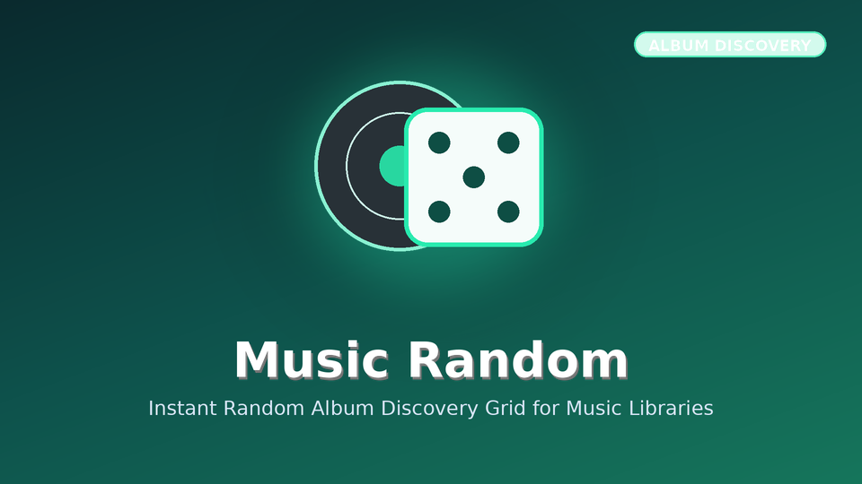

# Music Random (Jellyfin.Plugin.MusicRandom)



Adds a dedicated Random album discovery view to Music libraries in both Modern and Legacy UI for Jellyfin 12.4.

## Installation via Jellyfin Plugin Repository

Add the following repository URL in **Dashboard -> Plugins -> Repositories**:

```
https://raw.githubusercontent.com/koopjm/jellyfin-plugins/main/manifest.json
```
